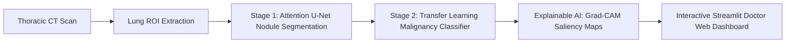

# 🫁 PulmoAI: Lung Cancer Detection & Malignancy Classification System
> **5th Semester Capstone Project**  
> *A 2-Stage CADe/CADx Deep Learning Framework for Pulmonary Nodule Detection, Malignancy Risk Grading, and Explainable AI (XAI) on CT Scans.*

---

## 📌 Project Overview
Lung cancer remains one of the leading causes of cancer-related mortality globally. Early detection of malignant pulmonary nodules via Computed Tomography (CT) scans substantially improves 5-year patient survival rates.

This project implements an end-to-end Computer-Aided Detection and Diagnosis (CADe/CADx) pipeline inspired by state-of-the-art literature published in *ScienceDirect (Biomedical Engineering Advances, 2025)*.



---

## ✨ Key Features & Architecture

1. **Stage 1: Attention U-Net Nodule Segmentation**
   * Incorporates **Spatial Attention Gates** to focus on suspicious lung lesions while filtering out normal vascular tree markings and rib bone artifacts.
   * Uses **Combo Loss (Focal Tversky Loss + BCE)** to overcome the extreme class imbalance in CT scans where nodules occupy $<0.1\%$ of total volume.

2. **Stage 2: Malignancy Classification (Benign vs. Malignant)**
   * Extracts detected nodule candidate patches and classifies them into **Benign (Low Risk)** vs. **Malignant (Cancerous)** using transfer learning backbones (**EfficientNet-V2 / ResNet-50**).

3. **Explainable AI (Grad-CAM XAI)**
   * Generates saliency heatmaps showing the morphological features (spiculation, density, ground-glass opacity) that influenced the prediction, overcoming the clinical "black box" hurdle.

4. **Clinical Evaluation Metrics**
   * Tracks **Sensitivity (Recall)**, **Specificity**, **Precision (PPV)**, **NPV**, **F1-Score**, **ROC-AUC**, and **Dice Similarity Coefficient**.

5. **Interactive Web Dashboard (`app.py`)**
   * Built with **Streamlit** for real-time CT slice upload, segmentation mask overlay, malignancy confidence gauges, and clinical report exports.

---

## 📂 Repository Structure

```
Lung_Cancer_Detection/
├── app.py                      # Interactive Streamlit Web UI Application
├── src/
│   ├── models/
│   │   ├── attention_unet.py   # Attention U-Net architecture & custom losses
│   │   └── malignancy_classifier.py # Stage-2 Transfer Learning Classifier
│   ├── xai/
│   │   └── gradcam.py          # Grad-CAM visual explainability module
│   ├── evaluation/
│   │   └── metrics.py          # Clinical & segmentation metrics calculator
│   └── utils/
│       └── ct_processor.py     # HU normalization, Lung ROI, & nodule cropper
├── notebooks/
│   ├── v1/                     # Baseline exploratory notebooks
│   └── v2/                     # Enhanced LUNA16 dataset processing notebooks
├── DATA/
│   └── annotations.csv         # LUNA16 ground-truth nodule coordinates
└── README.md
```

---

## 🚀 Quick Start & Installation

### 1. Clone & Install Dependencies
```bash
git clone https://github.com/Satyam-50/Lung_Cancer_Detection-capston-project-sem-5th-.git
cd Lung_Cancer_Detection-capston-project-sem-5th-
pip install -r requirements.txt   # or pip install tensorflow streamlit SimpleITK scikit-image opencv-python
```

### 2. Launch the Web Application
```bash
streamlit run app.py
```
Open `http://localhost:8501` in your browser.

---

## 📊 Dataset Benchmark
This project benchmarks against the gold-standard datasets:
* **LUNA16 (LUng Nodule Analysis 2016)**
* **LIDC-IDRI (Lung Image Database Consortium)**

For training locally, download `subset0.zip` from [Kaggle LUNA16](https://www.kaggle.com/datasets/luna16) and place it in `DATA/subset0/`.

---

## 📜 Academic Reference
* *Nguyen, M.N. (2025). "A scoping review of deep learning approaches for lung cancer detection using chest radiographs and computed tomography scans." Biomedical Engineering Advances, Elsevier (ScienceDirect).*
